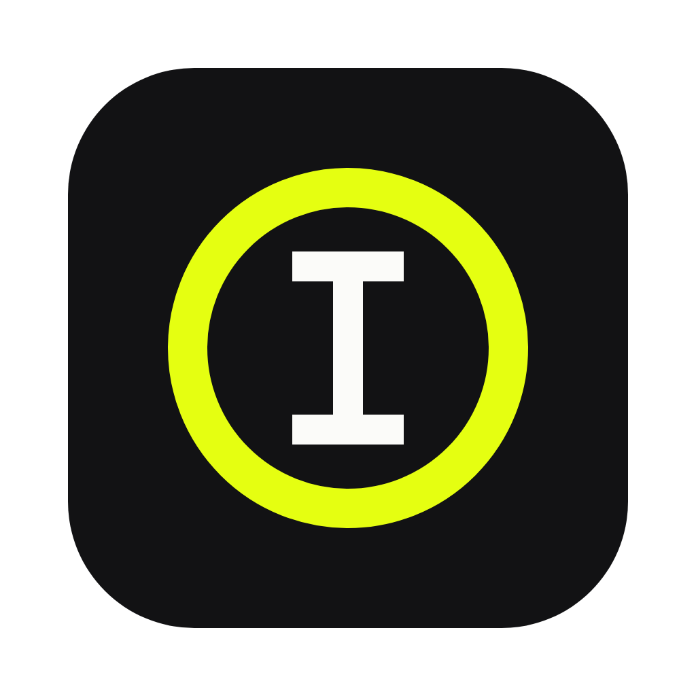

<p align="center"></p>

<h1 align="center">typeSirkel</h1>

<p align="center">A quiet markdown editor for people who write in folders.</p>

---

typeSirkel opens a folder of `.md` files and gets out of the way. You write on the left, read on the right, and a small marker walks down the outline as you move through your headings. Files stay plain markdown on your own disk. There are no accounts and nothing to migrate away from later.

It runs in the browser and as a desktop app for macOS and Windows. Both are the same code; only the way files are opened and saved changes.

## What it does

- Opens a whole folder and lists every markdown file in it, nested folders included
- Writes with a proper editor: syntax highlighting, fenced code in many languages, search, multiple cursors
- Type `/` for a menu of formats that shows the markdown it writes, so you never have to remember a mark
- Dictate with your voice, handy for a rough record of a meeting you tidy up later
- Shows a live preview side by side, or either one on its own
- Saves on its own a moment after you stop typing
- Follows you through the document with the lookout, an outline with a marker that travels to the heading you are in
- Helps you write with the AI you already pay for, through your own key
- Lets you share a link and edit the same draft with other people, live and end-to-end encrypted
- Lets Claude, Cursor or any MCP client work in your folder, and shows their edits as they land
- Exports a clean standalone HTML page, or prints to PDF
- Light and dark, following the system unless you say otherwise

## Shortcuts

| Keys | Does |
| --- | --- |
| / | Format menu |
| Cmd/Ctrl + S | Save now |
| Cmd/Ctrl + O | Open a folder |
| Cmd/Ctrl + B / I / E | Bold, italic, inline code |
| Cmd/Ctrl + K | Link |
| Cmd/Ctrl + F | Find |
| Cmd/Ctrl + 1 / 2 / 3 | Write, split, read |
| Cmd/Ctrl + J | Quill, the AI panel |
| Cmd/Ctrl + Shift + D | Dictate |
| Cmd/Ctrl + . | Quiet mode |
| Cmd/Ctrl + P | Print or save as PDF |

## Quill

Quill is the AI panel. Open it with Cmd/Ctrl + J, pick a provider and paste your key: Anthropic, OpenAI, OpenRouter, a local Ollama, or any endpoint that speaks the OpenAI chat format. Select a passage, or leave the cursor in a paragraph, and ask it to continue, tighten, fix, summarize or translate. You see the answer first and decide whether it goes in.

Your key is stored on your device and requests go straight from typeSirkel to the provider. There is no typeSirkel server in between. In the browser this depends on the provider allowing browser requests; the desktop app sends them from Rust and doesn't have that limit.

## Writing together

Open Share and start sharing. Anyone with the link can edit the draft with you and see where everyone's cursor is. If you shared a file from your folder, their changes land in your file as they type.

The link carries a key after the `#`, which browsers never send to a server. Every change is sealed with that key before it leaves your machine, and the relay in [`sync/`](sync/) only stores and forwards bytes it cannot read. Rooms nobody has touched for 30 days are deleted.

## Prompts

The sidebar carries a shelf of writing prompts: horror, fantasy, straight news, an article rewrite that never touches quotes, names, dates or places, SEO articles, tutorials and storyboards. Open one to copy it, or hand it to Quill so every request follows it.

Each prompt is a markdown file in [`prompts/`](prompts/) with a title, a category and a one line description in its front matter. Translations sit next to the original as `horror.id.md`, `horror.pt-BR.md`, `horror.ko.md`, `horror.th.md` and `horror.zh-Hans.md`, and the shelf shows the one matching your language, falling back to English. Adding a good prompt, or a translation, is a welcome first pull request.

## MCP

[`mcp/`](mcp/) is a small MCP server that gives an AI client your typeSirkel folder: list, read, search, outline, write and append, all limited to that folder. Until it's published to npm, build it from this repository with `cd mcp && pnpm install && pnpm build`, then point your client at it, for example in Claude Desktop's config:

```json
{
  "mcpServers": {
    "typesirkel": {
      "command": "node",
      "args": ["/path/to/typesirkel/mcp/dist/index.js", "/Users/you/Notes"]
    }
  }
}
```

The desktop app watches the folder, so an agent's edits show up in the open document without a reload.

## Download

Builds for macOS and Windows show up on the [releases page](https://github.com/aconymouse/typesirkel/releases). The browser edition runs at [sirkel.asia/write](https://sirkel.asia/write/). Opening whole folders in the browser needs a Chromium based browser; elsewhere it opens one file at a time.

The macOS build is not notarized yet. The first time, right-click the app and choose Open.

## Building it yourself

You need Node.js 22 or newer with pnpm, and for the desktop app, Rust plus the [Tauri prerequisites](https://v2.tauri.app/start/prerequisites/) for your system.

```bash
pnpm install
pnpm dev            # browser edition at http://localhost:1420
pnpm tauri dev      # desktop app with live reload
pnpm tauri build    # installers in src-tauri/target/release/bundle
```

## Finding your way around

The code is small and named after things on a writing desk.

| File | What lives there |
| --- | --- |
| `src/Desk.tsx` | The room everything sits in: open files, saving, modes, shortcuts |
| `src/slash.ts` | The `/` format menu |
| `src/guides.ts`, `src/tour.ts` | The welcome tour and the guides that type themselves |
| `src/Sheet.tsx`, `src/nib.ts` | The editor, built on CodeMirror 6 |
| `src/Proof.tsx` | The rendered preview, like a printer's proof |
| `src/Shelf.tsx` | The file list on the left |
| `src/Lookout.tsx`, `src/LookoutRow.tsx`, `src/walker.ts` | The outline, upright in the sidebar or flat on small screens, and the marker that walks its trail |
| `src/ink.ts` | Markdown to HTML, headings and word counts |
| `src/press.ts` | Exports |
| `src/drawer/` | Where files live: browser folders, single files, the desktop filesystem, or scratch |
| `src/quill/` | The AI panel and the providers it can talk to |
| `prompts/` | The prompt shelf, one markdown file per prompt |
| `src/landing/`, `src/site/` | The website: home, about with the FAQ, docs and support, prerendered in every language |
| `content/` | The words of the about, FAQ, docs and support pages, one markdown file per language |
| `src/circle/` | Shared drafts: Yjs, sealing, and the share panel |
| `src-tauri/` | The thin desktop shell |
| `sync/` | The relay for shared drafts, a Cloudflare Worker with a Durable Object per room |
| `mcp/` | The MCP server for AI clients |

## Contributing

Issues, prompts, translations and pull requests are all welcome. Keep changes small and the interface calm; if a feature needs a settings page to explain it, it probably wants to be simpler first. [CONTRIBUTING.md](CONTRIBUTING.md) explains how to set up, what a good pull request looks like and how to translate. Please read the [code of conduct](CODE_OF_CONDUCT.md), and report security problems privately as described in [SECURITY.md](SECURITY.md).

The full guide for writers lives at [sirkel.asia/docs](https://sirkel.asia/docs/).

## Support

typeSirkel is free and will stay that way. If it helps your writing and you want to chip in, there is [Saweria](https://saweria.co/aconymous) for QRIS and e-wallets in Indonesia and [PayPal](https://www.paypal.com/paypalme/sarangseo) from anywhere else. More at [sirkel.asia/support](https://sirkel.asia/support/).

## License

MIT
